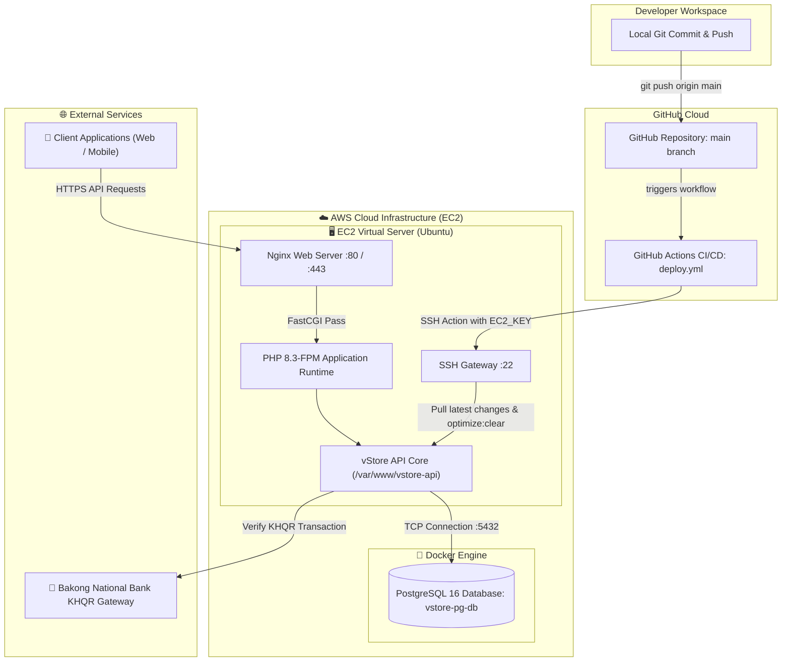
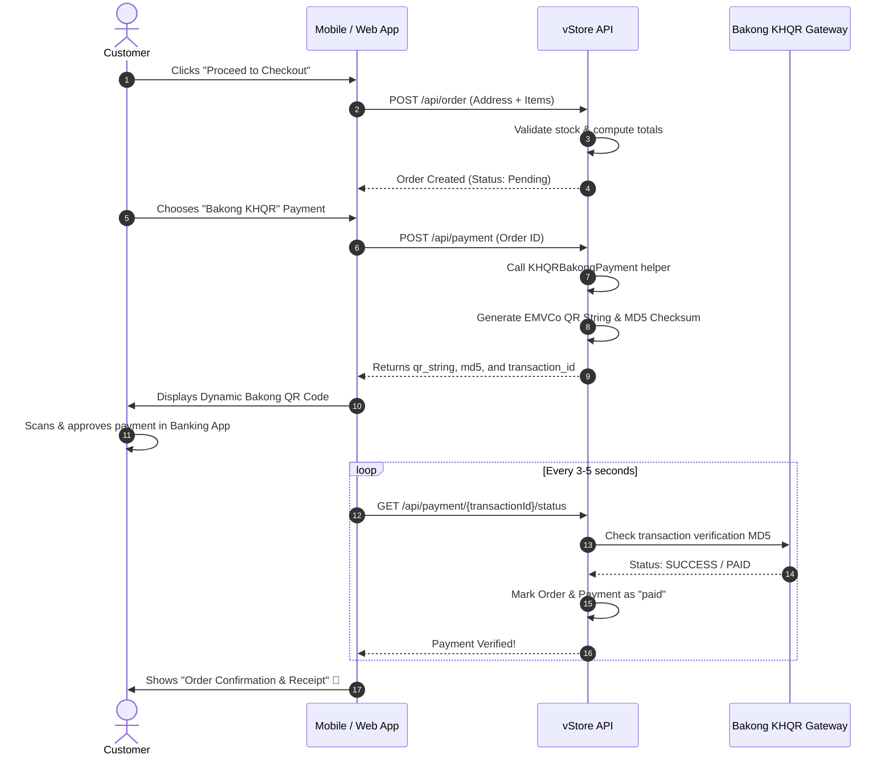

# vStore API

<p align="center">
  
</p>

<p align="center">
  <a href="#-tech-stack"></a>
  <a href="#-tech-stack"></a>
  <a href="#-tech-stack"></a>
  <a href="#-tech-stack"></a>
  <a href="#-tech-stack"></a>
  <a href="#-deployment-architecture"></a>
</p>

---

## Table of Contents

1. [Overview](#-overview)
2. [Problems We Solve](#-problems-we-solve)
3. [Key Features](#-key-features)
4. [Tech Stack](#️-tech-stack)
5. [Project Structure](#️-project-structure)
6. [Entity Relationship Diagram (ERD)](#-entity-relationship-diagram-erd)
    - [Diagram Visualization](#erd-diagram-visualization)
    - [Visual & Relationship Explanation](#erd-visual--relationship-explanation)
7. [Deployment Architecture](#️-deployment-architecture)
    - [Architecture Diagram](#deployment-architecture-diagram)
    - [CI/CD Flow Explanation](#cicd-flow-explanation)
8. [Payment Flow (Bakong KHQR Integration)](#-payment-flow-bakong-khqr-integration)
9. [Setup & Installation](#️-setup--installation)
    - [Prerequisites](#1-prerequisites)
    - [Option A: Local Setup](#option-a-local-environment-setup)
    - [Option B: Docker Setup](#option-b-docker-environment-setup)
    - [Environment Variables Guide](#environment-variables-guide)
10. [API Endpoints Reference](#-api-endpoints-reference)
11. [Conclusion & Roadmap](#-conclusion--roadmap)

---

## Overview

**vStore API** is a high-performance, secure, and developer-friendly e-commerce backend built with **Laravel**, **PostgreSQL**, and **Docker**. It is designed to serve modern web and mobile storefronts with ease.

The system handles the entire customer journey:

- User registration and authenticated sessions via **Laravel Sanctum**.
- Browsing categorized catalogs with pagination and sorting.
- Managing shopping carts and wishlists with automated subtotal calculation.
- Placing multi-item orders with automated stock validation.
- Generating real-time **Bakong KHQR** digital payment codes (National Bank of Cambodia standard) with instant transaction status checks.
- Administering users, categories, products, orders, and viewing sales analytics via an interactive administrative overview dashboard.

---

## Problems We Solve

Traditional mini-e-commerce backends often suffer from fragmented codebases, lack of real local payment gateways, and complicated deployment steps. **vStore API** solves these specific challenges:

| Challenge Faced                  | How vStore API Solves It                                                                                                                                       |
| :------------------------------- | :------------------------------------------------------------------------------------------------------------------------------------------------------------- |
| **Complex Payment Gateways**     | Implements direct **Bakong KHQR** integration, allowing instant cashless QR payments without requiring expensive third-party merchant setups.                  |
| **Race Conditions in Inventory** | Enforces atomic order placement with real-time stock deduction, preventing over-selling of limited inventory.                                                  |
| **Scattered API Responses**      | Standardizes all JSON payloads using an unified `ApiResponse` helper, ensuring clean, consistent responses across mobile and web clients.                      |
| **Weak Access Controls**         | Separates customer actions from administrative duties with dedicated Sanctum middleware and database-level role enforcement (`admin` vs `customer`).           |
| **Manual & Risky Deployments**   | Includes Docker containerization and a zero-downtime **GitHub Actions CI/CD** pipeline that automatically syncs and optimizes changes directly on **AWS EC2**. |

---

## Key Features

### 1. Authentication & RBAC

- Token-based authentication using **Laravel Sanctum**.
- Role-Based Access Control (`admin` and `customer`) enforced via custom `RoleMiddleware`.
- Self-service profile updates and secure password changes.

### 2. Product & Category Catalog

- Hierarchical product organization with automatic slug generation for categories.
- Public browsing with pagination, best-seller filtering, and product search.
- Protected admin routes for creating, updating, and removing items with image file storage.

### 3. Cart & Wishlist Operations

- Dynamic shopping carts linked to authenticated accounts.
- Quantity adjustment, item deletion, and cart clearing.
- One-click wishlist toggling for saving favorite items.

### 4. Address & Order Lifecycle

- Multiple shipping address management per user with a default address toggle.
- Order creation from cart items with automatic total and shipping fee computation.
- Comprehensive order states: `pending` ➔ `processing` ➔ `confirmed` ➔ `shipped` ➔ `completed` / `cancelled`.

### 5. Bakong KHQR Payment Integration

- Generates dynamic, standard-compliant EMVCo KHQR payloads with MD5 verification signatures.
- Real-time payment verification endpoint against the Bakong banking network.
- Support for Cash-on-Delivery (COD) and cashless KHQR transactions.

### 6. Admin Analytics Overview

- Real-time monthly revenue aggregation and month-over-month growth calculations.
- Live order status breakdown and transaction volume statistics.

---

## Tech Stack

- **Framework**: Laravel 11 / 12 (PHP 8.3+)
- **Database**: PostgreSQL 16 Alpine
- **Authentication**: Laravel Sanctum (Bearer Token)
- **Payment Engine**: Bakong KHQR PHP SDK (`khqr/bakong-khqr`)
- **Containerization**: Docker & Docker Compose
- **Web Server**: Nginx + PHP-FPM
- **CI/CD & Cloud**: GitHub Actions ➔ AWS EC2

---

## Project Structure

Below is an overview of the key files and architectural layers of **vStore API**:

```text
vstore-api/
├── .github/
│   └── workflows/
│       └── deploy.yml            # CI/CD pipeline: auto-deploy to AWS EC2 on git push
├── app/
│   ├── Enums/
│   │   ├── OrderStatus.php       # Enums: pending, processing, confirmed, shipped, completed, cancelled
│   │   └── Role.php              # Enums: admin, customer
│   ├── Exceptions/
│   │   ├── StockException.php    # Handles insufficient inventory errors
│   │   └── ...                   # Custom exceptions for uniform error responses
│   ├── Helpers/
│   │   ├── ApiResponse.php       # Standardized JSON response wrapper
│   │   └── KHQRBakongPayment.php # Generates dynamic KHQR string & MD5 checksum
│   ├── Http/
│   │   ├── Controllers/
│   │   │   ├── AuthController.php      # Login, registration, profile management
│   │   │   ├── ProductController.php   # Catalog CRUD & best-selling queries
│   │   │   ├── CartController.php      # Shopping cart management
│   │   │   ├── OrderController.php     # Checkout & order status progression
│   │   │   ├── PaymentController.php   # KHQR generation & transaction verification
│   │   │   └── OverviewController.php  # Sales & monthly revenue analytics
│   │   ├── Middleware/
│   │   │   └── RoleMiddleware.php      # RBAC route gatekeeper
│   │   └── Resources/                  # Eloquent API Transformation Resources
│   └── Models/                         # Eloquent Models (User, Product, Order, etc.)
├── database/
│   ├── migrations/               # Structured schema migrations for PostgreSQL
│   └── seeders/                  # Database seeders with test accounts and items
├── docker/
│   ├── nginx.conf                # Optimized Nginx server configuration
│   └── start.sh                  # Container startup script (migrations, config cache, services)
├── routes/
│   └── api.php                   # Versioned RESTful API routes
├── docker-compose.yml            # Local PostgreSQL 16 Alpine container definition
├── Dockerfile                    # Production container build (PHP 8.3-FPM + Nginx)
└── README.md                     # Project documentation
```

---

## Entity Relationship Diagram (ERD)

### ERD Diagram Visualization

The relational schema is built on top of PostgreSQL, maintaining referential integrity with foreign key constraints and cascading deletes where appropriate.

```mermaid
erDiagram
    USERS ||--o{ ORDERS : places
    USERS ||--o{ ADDRESSES : owns
    USERS ||--o| CARTS : has
    USERS ||--o{ WISHLISTS : saves

    CATEGORIES ||--o{ PRODUCTS : categorizes

    CARTS ||--o{ CART_ITEMS : contains
    PRODUCTS ||--o{ CART_ITEMS : "referenced in"

    ORDERS ||--o{ ORDER_ITEMS : contains
    ORDERS ||--o| PAYMENTS : "paid via"
    ADDRESSES ||--o{ ORDERS : "shipped to"
    PRODUCTS ||--o{ ORDER_ITEMS : "snapshot of"
    PRODUCTS ||--o{ WISHLISTS : "listed in"

    USERS {
        bigint id PK
        string name
        string email UK
        enum role "admin, customer"
        string password
        timestamp created_at
    }

    CATEGORIES {
        bigint id PK
        string name UK
        string slug UK
        string description
        enum status "active, inactive"
        timestamp created_at
    }

    PRODUCTS {
        bigint id PK
        string name
        string description
        string image
        decimal price
        integer quantity
        bigint category_id FK
        timestamp created_at
    }

    ADDRESSES {
        bigint id PK
        bigint user_id FK
        string recipient_name
        string phone
        string address_line
        string city
        boolean is_default
        timestamp created_at
    }

    CARTS {
        bigint id PK
        bigint user_id FK
        timestamp created_at
    }

    CART_ITEMS {
        bigint id PK
        bigint cart_id FK
        bigint product_id FK
        integer quantity
        timestamp created_at
    }

    WISHLISTS {
        bigint id PK
        bigint user_id FK
        bigint product_id FK
        timestamp created_at
    }

    ORDERS {
        bigint id PK
        bigint user_id FK
        bigint address_id FK
        string order_number UK
        enum status "pending, processing, comfirmed, shipped, completed, cancelled"
        decimal subtotal
        decimal shipping_fee
        decimal total
        timestamp created_at
    }

    ORDER_ITEMS {
        bigint id PK
        bigint order_id FK
        bigint product_id FK
        string product_name
        decimal unit_price
        integer quantity
        decimal subtotal
        timestamp created_at
    }

    PAYMENTS {
        bigint id PK
        bigint order_id FK
        string transaction_id
        string qr_string
        string md5
        enum method "khqr, cod"
        enum status "pending, failed, paid, refunded"
        decimal amount
        timestamp created_at
    }
```



### ERD Visual & Relationship Explanation

> [!NOTE]
> Understanding the relationship flow ensures smooth API interactions and prevents orphaned records:

1. **User Identity Core (`USERS`)**:
    - Each customer owns an active `CARTS` record, a collection of `ADDRESSES`, and multiple `ORDERS`.
    - The `role` column (`admin` / `customer`) defines access permission across the API.
2. **Product Catalog (`CATEGORIES` ➔ `PRODUCTS`)**:
    - Every product belongs to a specific category. Deleting a category safely cascades or restricts depending on inventory policy.
    - Products maintain a live `quantity` column which is checked during checkout.
3. **Shopping Cart & Wishlist (`CARTS` ➔ `CART_ITEMS` & `WISHLISTS`)**:
    - Active user carts store line items pointing to specific products and quantities.
    - Wishlists allow customers to bookmark products for future purchase without reserving stock.
4. **Checkout & Order Snapshot (`ORDERS` ➔ `ORDER_ITEMS`)**:
    - When an order is placed, line items are saved in `ORDER_ITEMS` with **frozen price snapshots** (`unit_price` and `product_name`). This guarantees that future product price modifications never alter historical receipt values.
5. **Payment Transaction Binding (`ORDERS` ➔ `PAYMENTS`)**:
    - Each order is linked to a payment transaction containing the exact `transaction_id`, the generated `qr_string` for Bakong scanning, the cryptographic `md5` hash, and the transaction state (`pending`, `paid`, `failed`, or `refunded`).

---

## Deployment Architecture

### Deployment Architecture Diagram

The production infrastructure runs on **AWS EC2** with automated deployments triggered by **GitHub Actions** workflows:



### CI/CD Flow Explanation

> [!TIP]
> The automated pipeline ensures your production instance is always in sync with minimal downtime:

1. **Trigger**: Pushing code to the `main` branch immediately triggers the `.github/workflows/deploy.yml` workflow.
2. **Secure Handshake**: The runner authenticates with your AWS EC2 instance using stored GitHub Secrets (`EC2_HOST`, `EC2_KEY`, `EC2_PORT`, and `EC2_USER`).
3. **Atomic Pull**: The remote host navigates to `/var/www/vstore-api` and runs `git pull --ff-only origin main` to pull fast-forward commits cleanly.
4. **Optimization**: Laravel's optimization cache is cleared using `php artisan optimize:clear`, compiling route, config, and view caches for peak execution speed.
5. **Database Isolation**: The PostgreSQL 16 database runs inside a resilient Docker container (`vstore-pg-db`) with persistent data volumes (`vstore_pgdata`) mounted on the EC2 host.

---

## Payment Flow (Bakong KHQR Integration)

Below is the sequence diagram explaining how customer checkout integrates with the **Bakong KHQR** banking network:



---

## Setup & Installation

### 1. Prerequisites

Make sure the following tools are installed on your machine:ntrollers\CategoryController;
use App\Http\Controllers\OrderController;
use App\Http\Controllers\OverviewController;
use App\Http\Controllers\PaymentController;
use App\Http\Controllers\ProductController;
use App\Http\Controllers\WishlistController;
use Illuminate\Support\Facades\Route;

//auth routes

Route::group(["prefix" => "auth"], function () {
Route::post('/login', [AuthController::class, 'login']);
Route::post('/register', [AuthController::class, 'register']);
});

Route::middleware('auth:sanctum')->prefix('auth')->group(function () {
Route::get('/me', [AuthController::class, 'me']);
Route::patch

- **PHP**: `>= 8.2` (PHP 8.3 or 8.5 recommended) with `pdo_pgsql`, `bcmath`, `gd`, `zip`
- **Composer**: `>= 2.x`
- **Docker & Docker Compose**: (for running the PostgreSQL container)
- **Git**

---

### Option A: Local Environment Setup

#### 1. Clone the repository

```bash
git clone https://github.com/chamreunvira/vstore-api.git
cd vstore-api
```

#### 2. Install dependencies

```bash
composer install
```

#### 3. Environment configuration

Copy the example environment file and generate the application key:

```bash
cp .env.example .env
php artisan key:generate
```

#### 4. Spin up the PostgreSQL Docker container

```bash
docker compose up -d
```

> This starts the PostgreSQL 16 container (`vstore-pg-db`) running on port `5432`.

#### 5. Configure `.env` for Database & Bakong

Update your `.env` file with the following settings:

```dotenv
DB_CONNECTION=pgsql
DB_HOST=127.0.0.1
DB_PORT=5432
DB_DATABASE=vstore_db
DB_USERNAME=vira
DB_PASSWORD=vira123

# Bakong KHQR Payment Credentials
BAKONG_ACCOUNT_ID="your_bakong_account@bkrt"
BAKONG_MERCHANT_NAME="Your Store Name"
BAKONG_MOBILE_NUMBER="012345678"
BAKONG_TOKEN="your_bakong_api_jwt_token"
```

#### 6. Run migrations & seeders

```bash
php artisan migrate --seed
```

#### 7. Start the local server

```bash
php artisan serve
```

Your API is now live at: `http://localhost:8000`!

---

### Option B: Docker Environment Setup

To run both the application and the database in unified production-ready containers:

```bash
# 1. Build and start the containers
docker build -t vstore-api .
docker run -d -p 10000:10000 --name vstore-app --env-file .env vstore-api

# 2. Or using your custom compose workflow
docker compose up --build -d
```

---

### Environment Variables Guide

| Variable               | Description                         | Example / Default                    |
| :--------------------- | :---------------------------------- | :----------------------------------- |
| `APP_ENV`              | Application environment state       | `local` / `production`               |
| `APP_KEY`              | 32-character AES encryption key     | Generated via `artisan key:generate` |
| `DB_CONNECTION`        | Database driver                     | `pgsql`                              |
| `DB_PORT`              | PostgreSQL listening port           | `5432`                               |
| `DB_DATABASE`          | Database name                       | `vstore_db`                          |
| `BAKONG_ACCOUNT_ID`    | Registered Bakong Bank Account ID   | `merchant@bkrt`                      |
| `BAKONG_MERCHANT_NAME` | Merchant name shown on banking apps | `vStore KH`                          |
| `BAKONG_TOKEN`         | Bakong Open API bearer token        | JWT string                           |

---

## API Endpoints Reference

All routes are prefixed with `/api`. Protected routes require the `Authorization: Bearer <sanctum_token>` header.

### Authentication (`/api/auth`)

| Method  | Endpoint         | Access        | Description                                   |
| :------ | :--------------- | :------------ | :-------------------------------------------- |
| `POST`  | `/auth/register` | Public        | Register a new customer account               |
| `POST`  | `/auth/login`    | Public        | Authenticate and receive Sanctum bearer token |
| `GET`   | `/auth/me`       | Authenticated | Retrieve current user profile                 |
| `PATCH` | `/auth/profile`  | Authenticated | Update user name and email                    |
| `PATCH` | `/auth/password` | Authenticated | Update account password                       |
| `POST`  | `/auth/logout`   | Authenticated | Revoke current access token                   |

### Products & Categories (`/api/products`, `/api/categories`)

| Method      | Endpoint                 | Access     | Description                                |
| :---------- | :----------------------- | :--------- | :----------------------------------------- |
| `GET`       | `/products`              | Public     | List products (with filtering, pagination) |
| `GET`       | `/products/best-selling` | Public     | Retrieve top-selling products              |
| `GET`       | `/products/{id}`         | Public     | Get specific product details               |
| `POST`      | `/products`              | Admin Only | Create a new product (with image upload)   |
| `PUT/PATCH` | `/products/{id}`         | Admin Only | Update an existing product                 |
| `DELETE`    | `/products/{id}`         | Admin Only | Delete a product                           |
| `GET`       | `/categories`            | Public     | List all active product categories         |
| `POST`      | `/categories`            | Admin Only | Create a category                          |

### Cart & Wishlist (`/api/cart`, `/api/wishlist`)

| Method   | Endpoint            | Access        | Description                             |
| :------- | :------------------ | :------------ | :-------------------------------------- |
| `GET`    | `/cart`             | Authenticated | Get current user's cart and item totals |
| `POST`   | `/cart/items`       | Authenticated | Add item to cart                        |
| `PATCH`  | `/cart/items/{id}`  | Authenticated | Update item quantity                    |
| `DELETE` | `/cart/items/{id}`  | Authenticated | Remove single item from cart            |
| `DELETE` | `/cart/items/clear` | Authenticated | Clear all items from cart               |
| `GET`    | `/wishlist`         | Authenticated | List all saved wishlist products        |
| `POST`   | `/wishlist`         | Authenticated | Toggle or save item to wishlist         |
| `DELETE` | `/wishlist/{id}`    | Authenticated | Remove item from wishlist               |

### Addresses & Orders (`/api/addresses`, `/api/order`)

| Method     | Endpoint             | Access        | Description                                            |
| :--------- | :------------------- | :------------ | :----------------------------------------------------- |
| `GET/POST` | `/addresses`         | Authenticated | List or create shipping addresses                      |
| `GET`      | `/order`             | Authenticated | List all orders (Admin views all, Customer views self) |
| `POST`     | `/order`             | Authenticated | Place a new order from current cart                    |
| `GET`      | `/order/{id}`        | Authenticated | View order details with line items                     |
| `PATCH`    | `/order/{id}/status` | Admin Only    | Advance order status (`shipped`, `completed`, etc.)    |

### Payments (`/api/payment`) & Analytics (`/api/overview`)

| Method | Endpoint                          | Access        | Description                                          |
| :----- | :-------------------------------- | :------------ | :--------------------------------------------------- |
| `POST` | `/payment`                        | Authenticated | Generate dynamic Bakong KHQR for an order            |
| `GET`  | `/payment/{transactionId}/status` | Authenticated | Check live status of a payment                       |
| `GET`  | `/payment`                        | Admin Only    | List all payment transactions                        |
| `GET`  | `/overview`                       | Admin Only    | Sales dashboard metrics & monthly revenue graph data |

---

## Conclusion & Roadmap

**vStore API** provides a solid, production-ready foundation for modern e-commerce experiences. By pairing a battle-tested PHP/Laravel backend with PostgreSQL, Docker containerization, and native **Bakong KHQR** digital payments, it eliminates common checkout frictions in Southeast Asian markets and simplifies deployment on cloud providers like AWS.

### Future Roadmap

- [ ] Push notification dispatching via Firebase Cloud Messaging (FCM).
- [ ] Automated PDF invoice generation upon order completion.
- [ ] Multi-vendor merchant marketplace extensions.
- [ ] Redis-backed queue workers for background email receipts.

---

<p align="center">
  Built with ❤️ for scalable e-commerce engineering.
</p>
